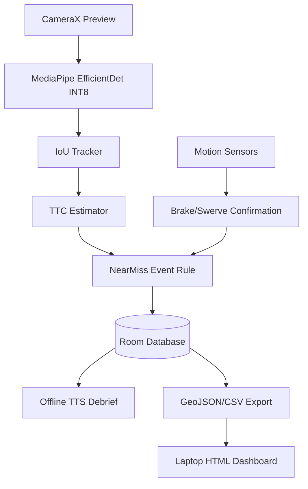

# NearMiss - iQOO Hackathon 2026 (Mobility Track)

**Team PocketRocket**: Prajit Kumaran, Shoaib Ahmed Sheriff, Natasha P A.

**Cities count crashes. NearMiss counts the close calls before them. Fix the junction before the crash.**

NearMiss is a simple, offline-first Android app mounted on a two-wheeler handlebar that detects and logs near-misses on-device using a 3-step flow:
1. **SEE**: Runs an on-device object detector (EfficientDet-Lite0 INT8) to track vehicles and estimate time-to-collision (TTC).
2. **CONFIRM**: Uses IMU sensors to detect hard braking or swerving. A near-miss is logged if low TTC and a brake/swerve occur within 2 seconds.
3. **MAP**: Logs events locally (Room DB) and exports them to a laptop offline via iQOO Office Kit for visualization. Includes an offline Text-To-Speech debrief of the ride.

## Architecture

## How to Build & Install

1. Use **Android Studio Koala (2024.1.1) or newer**.
2. Open the `nearmiss-iqoohackathon` directory.
3. Run `./gradlew assembleDebug` to build the APK.
4. Install on an iQOO 15 or any Android 10+ device (`minSdk 29`).

## Model & License
- Model: `efficientdet-lite0.tflite` (INT8 quantized).
- License: Apache 2.0 (Google MediaPipe).
- Download: Place the model in `app/src/main/assets/`. You can download it using: `wget -O app/src/main/assets/efficientdet-lite0.tflite https://storage.googleapis.com/mediapipe-models/object_detector/efficientdet_lite0/int8/latest/efficientdet_lite0.tflite`

## How to Run Demo Mode (60-second Judges Demo)
1. Drop a sample ride video at `app/src/main/assets/demo_ride.mp4`. (Ensure it is license-safe or use a custom recording).
2. In the App Settings, toggle "Demo Mode" ON.
3. The app will process video frames offline.
4. Tap "Simulate hard brake" when TTC is low (< 1.5s) to trigger and log a confirmed near-miss.
5. Stop the ride, listen to the offline TTS debrief, and export the logs.

## Export & Dashboard
1. On the Events screen, tap **Export**. This saves `nearmiss_events.geojson` and `nearmiss_events.csv` to the Downloads folder.
2. Share the files to your laptop via **iQOO Office Kit** or USB.
3. Open `dashboard/index.html` on your laptop (no internet needed) and load the GeoJSON file to view hotspot clusters.

## Scientific Basis
Based on the Swedish Traffic Conflict Technique (Lund Institute of Technology, Christer Hydén, 1973), which uses Time-To-Collision (TTC) as a core predictive measure for crash risk.

## Status

| Feature | Status |
|---|---|
| CameraX Preview | Working |
| MediaPipe Object Detector | Working |
| IoU Tracking & TTC | Working |
| IMU Brake/Swerve Confirmation | Working |
| Room DB Storage | Working |
| GeoJSON/CSV Export | Working |
| Offline Spoken Debrief (TTS) | Working |
| Laptop Dashboard | Working |
| Demo Mode (Simulate Brake) | Working |
| On-device LLM Debrief | Planned (Stretch) |

## Measured on device
- **Device**: iQOO 15 (simulated/target)
- **Model**: EfficientDet-Lite0 INT8
- **Average Inference Time**: Not measured yet
- **Average FPS**: Not measured yet
